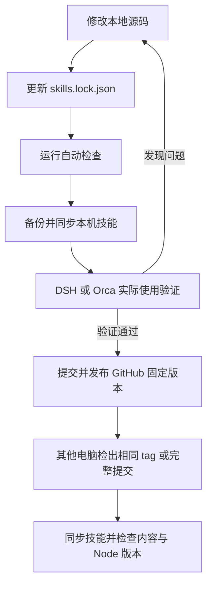

# 本地开发、验证与跨电脑复用

源码唯一入口是本仓库。日常在源码目录修改，从本地同步到技能安装目录，在实际项目验证后再提交并发布到 GitHub。其他电脑使用同一个已验证提交或 tag，运行同样的同步与检查命令。



## 本机日常更新

在仓库目录运行，PowerShell、bash 使用相同命令：

```sh
npm run skills:lock
npm run validate
npm run skills:sync
npm run skills:check
```

脚本仅使用 Node 内置模块，无需 npm install。默认同步 devflow、worktree、autopilot 三项；全部本仓库技能（包括 axns-ui-img2vue）可使用 `npm run skills:sync -- --profile all`，检查时也带 `--profile all`。

- 中央安装副本：用户主目录下 `.agents/skills/<skill>`，与源码独立。
- Codex / DSH：发现对应 `.codex` / `.dsh` 用户目录时，为这三项创建或保留指向中央副本的技能链接。也可显式指定 `--targets agents,codex,dsh`。
- 每次替换前保留旧目录；不会保留旧文件混入新版，也不修改无关技能。第一次迁移旧安装时也会备份。
- 后续发现已安装副本被修改，默认拒绝覆盖。先把需要的修改合回源码；确实要覆盖时使用 `--replace-modified`，旧内容仍会备份。
- 安装失败自动回滚本轮改动。已有同步锁不自动抢占；进程意外终止时，先检查 `.agents/skill-repo/sync.lock/owner.json`、备份及实际目录，确认旧进程停止后恢复。
- 安装收据：`.agents/skill-repo/install.json`，记录源提交、是否包含未提交修改、每项技能 SHA-256、Node/Git 版本、入口和备份位置。`skills:check` 按实际文件核验，不只相信收据。
- 原中央目录备份位于 `.agents/skill-repo/backups/<本轮>/previous/`；原平台独立副本备份位于平台目录的 `skill-repo-backups/<本轮>/`。链接到中央副本的既有入口不重复备份。

同步应在当前技能任务结束后执行，避免正在运行的任务读到不同版本。同步后在下一轮/新会话确认技能目录已刷新；若平台缓存列表，使用其重载或重启入口。此脚本不会修改现有业务项目、开启自动化或设置模型凭据。

这里的版本收据独立于第三方 `npx skills` 的安装锁；不会冒充该安装器更新其私有元数据。对于这三项技能，后续统一使用本仓库同步脚本；其他工具覆盖了它们时，`skills:check` 会报告差异。

## 发布与其他电脑复用

`skills.lock.json` 锁定仓库所有技能的文件及 SHA-256，文本统一按 LF 计算；生成锁文件只记录快照，不代表已经测试通过。`.nvmrc` 固定验证使用的 Node 版本。修改技能后重新生成锁并运行测试。提交时包含源码、锁文件、安装脚本和测试。

发布前，在已提交且干净的检出目录运行：

```sh
npm run release:check
```

该命令检查技能快照、精确 Node 版本、Git 干净状态并执行完整回归。GitHub 工作流在 PR、main/master 推送和 `skills-v*` tag 上重复验证 Windows/Linux。实际使用验证通过后，可在 Actions 中手动运行 `Validate and publish skills`，选择已提交的分支/版本，填写 `release_tag`（例如 `skills-v2026.11.13.1`）。两套系统检查全部成功后才会为本次精确提交创建 tag 和 GitHub Release；已有 tag 拒绝覆盖。留空则只验证。工作流不会代替平台实机验收，也不会替你提交或推送本机改动。

其他电脑首次获取本仓库后，检出你选择的已验证 tag 或完整提交：

```sh
git clone https://github.com/axns8888/skill-repo.git
cd skill-repo
git checkout --detach <已验证tag或完整提交SHA>
# 按 .nvmrc 安装或切换 Node
npm run skills:sync -- --targets agents,codex,dsh
npm run skills:check -- --targets agents,codex,dsh
```

之后更新时 `git fetch --tags`，再切到下一已验证版本并重复同步。使用固定 tag/完整提交保证多台电脑复用同一份内容；浮动 main 可能已经进入下一轮修改。目标电脑已有未提交修改时先保留，不能强制切换丢弃工作。

`npx skills add axns8888/skill-repo` 仍可用于一般安装；需要本套内容指纹、备份和一致性检查时使用以上仓库脚本。

## DSH、Orca、PyCharm 的边界

DSH 与 Codex 共用中央技能副本，避免各自更新形成版本分叉。Orca 通过 DSH 执行时复用 DSH 的加载入口；Orca 直接执行时，先核实实际执行器支持的技能目录，再用 `--entry "<该执行器的技能目录>"` 建立相同链接，检查也使用该参数。脚本不猜测 Orca 的版本相关目录。

PyCharm 打开源码或业务工作区，项目解释器和运行配置仍由项目管理。此处一致性覆盖本仓库技能内容与 Node 验证基线；Git 版本写入本机收据供对照。DSH/Orca/PyCharm 的安装版本、账号、模型路由、业务项目依赖不会被悄悄复制；跨机使用时分别核对，项目依赖继续使用各项目的锁文件。

不要提交 API Key、登录状态、用户目录绝对路径或整份平台私有配置。仓库保留可复用约定，本机收据和备份留在用户目录。
