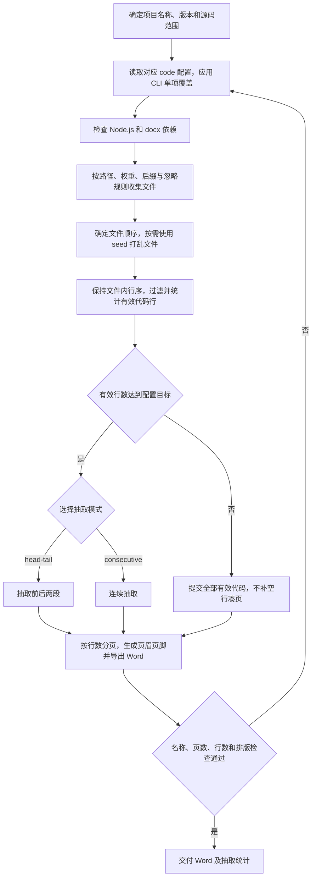

# 软著源码文档：axns-copyright-gen-code

从项目真实源码中按配置选择文件、统计有效代码行并导出 Word，适用于单独生成源码材料或作为软著聚合流程的一步。

## 工作流程

默认配置为 60 页、每页 50 行有效代码，head-tail 模式前后各 30 页；这是技能默认值，具体执行以项目配置与提交要求为准。默认目标对应约 3000 行有效代码，不足时输出全部，实际页数可能少于目标。

打乱仅作用于文件顺序，文件内部代码保持原有行序；启用打乱时记录 seed，以便复现。

## 输入与执行

需要项目名称与版本、源码路径及权重、文件后缀和忽略项，以及对应的 *-ruanzhu-code-config.md。运行入口为 [generate-code-doc.js](scripts/generate-code-doc.js)，参数与依赖安装见 [脚本说明](scripts/README.md)。

脚本依赖 Node.js 与 docx，可复用目标仓库 _doc/软著申请/.docx-tools 中的依赖。CLI 可覆盖配置中的单项参数。

## 交付内容

默认输出 _doc/软著申请/〈项目名称〉-源码文档-v*.docx，同时报告文件数、有效行数、实际页数、前后段抽取情况、是否提交全部，以及启用打乱时使用的 seed。这里的有效代码行与登记信息技能统计的物理行数口径不同。

执行细则见 [SKILL.md](SKILL.md)，版式见 [Word 样式](references/docx-style.md)与[格式约定](references/format.md)，调用示例见 [提示词](references/quick-prompt.md)。
