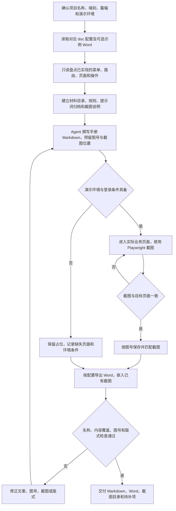

# 软著操作说明书：axns-copyright-gen-doc

依据仓库已经实现的功能，为一个项目端生成操作手册 Markdown、Word 和页面截图。正文由 Agent 根据代码与真实页面撰写，脚本负责截图辅助和文档导出等具体步骤。

## 工作流程

截图优先使用本机 Chrome / Edge，必要时使用 Chromium。必须核实登录后的业务页面，避免把登录页当成目标截图。演示环境暂不可用时可以交付带占位的文档，并清楚列出尚缺截图。

## 输入与内容组织

输入包括仓库、项目名称、端别、对应的 *-ruanzhu-doc-config.md、演示地址和登录条件，可选提供示例 Word。每个端单独成册；默认目标篇幅为每端不少于 8000 字，按实际要求调整。

Agent 先核实页面和操作事实，再组织封面、目录、系统简介、运行环境、登录、各功能操作步骤、字段说明、常见问题和附录。仅后端 API 的项目需另行确定接口说明范围，不生成虚构的界面操作手册。

## 交付内容

默认在 _doc/软著申请/ 下输出〈项目名称〉-操作手册-v*.md 与 .docx，并保存 Screenshot-〈端〉/ 截图目录。交付时附重新生成命令和未完成页面说明；导出器根据图号匹配已有截图，缺图处保留占位。

执行细则见 [SKILL.md](SKILL.md)，章节结构见 [提纲](references/outline.md)，内容要求见 [写作规则](references/writing-rules.md)，版式见 [Word 样式](references/docx-style.md)，调用示例见 [提示词](references/quick-prompt.md)，配置素材见 [模板说明](templates/README.md)。
