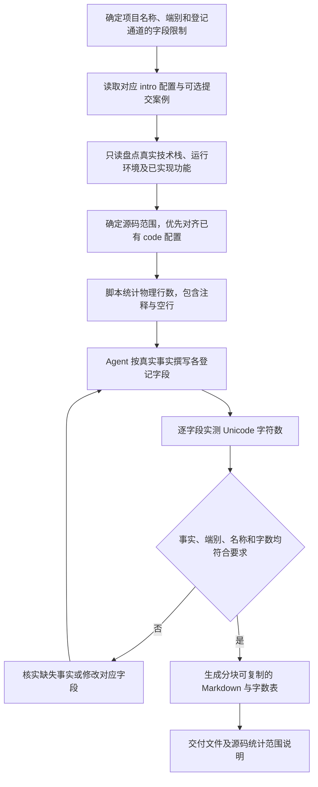

# 软著登记信息：axns-copyright-gen-intro

把仓库事实整理为可逐字段复制到登记表的 Markdown，包括环境、编程语言、源程序量、开发目的、主要功能和技术特点。

## 工作流程

环境信息可参考用户提供的提交案例格式，功能文案仍依据当前项目。多端分别生成，主要功能中不混入其他端专属能力或尚未实现的规划。

## 输入与统计口径

输入包括项目名称、端别、仓库路径、对应的 *-ruanzhu-intro-config.md、源码统计范围，以及用户实际使用通道的字段限制。单独使用时也可依据明确的任务输入确定范围。

源码统计入口为 [count-source-lines.js](scripts/count-source-lines.js)。这里统计物理行数，包含注释与空行；源码 Word 技能统计的是有效代码行，两者不应直接互换。

字数按 Unicode 字符数实测。技能默认主要功能为 500～1300 字，多数环境类短字段不超过 50 字、技术特点不超过 100 字；用户给出的实际通道限制优先，详见 [字段限制](references/field-limits.md)。

## 交付内容

默认输出 _doc/软著申请/〈项目名称〉-软著登记信息.md。文件包含逐字段代码块、实际字数表和源码统计口径，便于分段复制与复核。

执行细则见 [SKILL.md](SKILL.md)，写法见 [风格指南](references/style-guide.md)，调用示例见 [提示词](references/quick-prompt.md)，成品结构见 [登记信息示例](templates/软著登记信息.example.md)。
