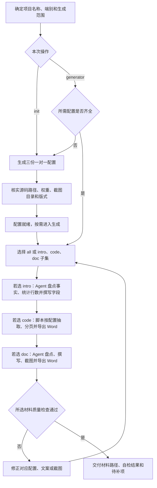

# 软著材料聚合编排：axns-copyright-gen

把一个项目或一个端的配置与三套材料对应起来：登记信息、源码 Word、操作手册及截图。需要同时安装三个子技能；只生成其中一套时，也可直接使用对应子技能。

## 工作流程

先用 init 建立配置，再由 Agent 编排 generator 流程。图中三个子流程按所选范围执行，全部生成时建议依次完成登记信息、源码文档、操作手册。

图中的子流程仅执行选中的项目。多端分别使用不同的项目名称、配置和输出，避免把管理端与员工端的材料混在一起。

## 脚本与 Agent 各做什么

| 入口 | 实际工作 |
| --- | --- |
| init | 创建缺失的 doc、code、intro 配置；显式使用 --force 才覆盖 |
| generator 脚本 | 校验配置，运行可脚本化的源码导出；已有手册 Markdown 时可导出 Word，并输出需 Agent 处理的待办 |
| Agent 编排 | 撰写登记信息和手册、操作演示环境获取截图、检查三套材料的一致性 |

仅运行 CLI 不会自动完成全部正文与截图。演示环境、素材或字段事实不足时，应在交付中说明待补项。

## 输入与产出

输入包括仓库路径、项目名称、端别、源码路径及权重、演示环境和截图目录。默认在目标仓库的 _doc/软著申请/ 保存三份配置与生成材料。

| 子技能 | 产出与流程 |
| --- | --- |
| [axns-copyright-gen-intro](../axns-copyright-gen-intro/README.md) | 登记字段 Markdown、字数表、源码统计口径 |
| [axns-copyright-gen-code](../axns-copyright-gen-code/README.md) | 源码 Word、抽取和分页统计 |
| [axns-copyright-gen-doc](../axns-copyright-gen-doc/README.md) | 操作手册 Markdown / Word、页面截图 |

执行细则见 [SKILL.md](SKILL.md)，参数见 [CLI 说明](references/cli.md)，材料对应关系见 [目录约定](references/layout.md)，调用示例见 [提示词](references/quick-prompt.md)。
