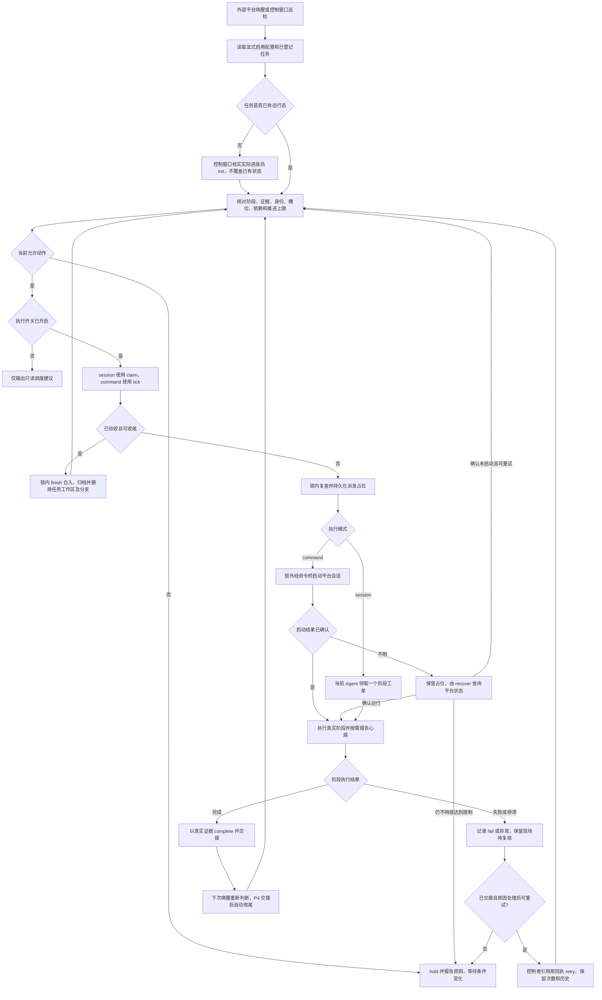

# axns-devflow 的可选自驱调度扩展

与 `axns-devflow` 同时安装；需要多任务隔离时再安装 `axns-devflow-ext-worktree`。需要 Node.js 和可用的 Git（worktree 模式）。安装后项目仍默认手动模式。

本版本包含只读判定脚本和默认关闭的通用执行层：session 模式供 DSH/Orca 已启动的自动化会话领取一个阶段；command 模式通过接入方的命令桥启动和查询会话。Orca 可生成禁用状态的自动化安装计划；本仓库没有实际安装平台定时任务。

## 工作流程

这项扩展调度已经登记并获授权的任务。默认关闭执行；开启执行后，缺省推进到 P4 并支持自动本地合入、归档、删除本任务 worktree/分支。已有配置中的显式 P3 或 finish_task:false 继续生效，需要调整才能采用完整闭环。



session 模式由 DSH / Orca 已启动的 Agent 领取工单；command 模式需要接入方提供可执行的启动与查询 JSON 命令桥。派发结果不明时通过 recover 核对，不能盲目重复启动。worktree 模式还需满足范围和修改权检查；显式人工验收阻塞只等待当前任务。

只读入口 autopilot.cjs 始终输出建议；执行与回调使用 runner.cjs。Orca 适配器目前生成禁用状态的安装计划，实际定时任务尚未安装；DSH 按通用会话协议接入，具体产品接口需要接入方落实。接入方式见 [平台说明](references/platforms.md)，占位、回调与恢复细节见 [执行说明](references/execution.md)。

## 1. 显式启用

先按宿主初始化最低目录，在主检出目录 `AGENTS.md` 声明：

```yaml
extensions: [autopilot]
autopilot_config: _plan/prompts/autopilot.json
```

需要 worktree 时，改为：

```yaml
extensions: [worktree, autopilot]
integration_branch: main
lock_timeout_minutes: 120
autopilot_config: _plan/prompts/autopilot.json
```

支持上述单行列表及简单缩进列表。配置路径相对主检出目录，可以用引号包含空格；不支持完整 YAML、重复键或路径越界。技术栈、模型账号、项目授权和运行命令由项目维护。

在主检出目录 `.gitignore` 增加：

```gitignore
/_plan/autopilot/
```

worktree 的其他忽略项和旧单指针迁移要求仍按其 README 执行。不要把调度运行态提交到仓库或放进任务 worktree；后者会阻止 worktree 的干净结案检查。

## 2. 配置与首次巡检

建立 `_plan/prompts/autopilot.json`。建议先用只读配置：

```json
{
  "version": 1,
  "slots": 2,
  "capabilities": {
    "advance": { "enabled": false, "max_stage": "P4" },
    "switch_model": { "enabled": false },
    "open_window": { "enabled": false, "only_registered": true },
    "finish_task": { "enabled": false }
  }
}
```

```powershell
node "<扩展目录>/scripts/autopilot.cjs" status --project "<项目>"
node "<扩展目录>/scripts/autopilot.cjs" decide --project "<项目>"
```

输出始终为 JSON，`--json` 是兼容选项。未启用返回 `enabled: false`、退出码 0；错误为 1；没有可执行动作且存在需处理任务时为 2。任务失败、超时或升级只 hold 自身；独立任务仍可推进并退出 0。recovery_count 表示由 AI 先诊断恢复的异常，needs_human_count 仅表示需要用户决定或显式确认的任务。全局读取/配置/协调异常退出 1、不返回可执行建议。显式人工验收等待维持退出 0；blocking_human_count 为 0 表示没有整轮阻断项。

## 3. 接入一个已登记任务

任务仍按宿主 P1 登记；多任务必须经过 worktree 的 scope 和持权检查。本扩展不发现未来需求、不登记新任务。单任务读取 `_plan/.active_plan`；worktree 读取主检出目录的活动及归档指针。

控制窗口核实任务已有授权、计划及当前进度后，在主检出目录建立 `_plan/autopilot/<task-id>/stage.json`：

```json
{
  "task_id": "20261112-example",
  "stage": "P2",
  "state": "ready",
  "owner": "controller/example",
  "updated_at": "2026-11-12T15:00:00+08:00",
  "attempts": 0
}
```

以上日期、任务和阶段按实际替换。`ready` 表示等待执行当前阶段；`completed` 表示当前阶段已完成，须填写证据路径，并把 status 返回的 `head`、`worktree_snapshot` 分别写入 `completed_head`、`completed_worktree`（非 Git 的 head 为 null，内容快照仍必填）。完整规则见 [协议](references/protocol.md)，不要因看到文件就补写完成。

接好平台预留与恢复机制后，再把 `advance.enabled`、`open_window.enabled` 改为 `true`。最小建议模式可以只写 `{ "version": 1 }`，其默认上限为 P4、默认允许 worktree 收尾，实际执行仍关闭。没有模型表时沿用现有模型；选择模型前由平台验证可用性。

## 4. 执行与验收边界

runner 已实现 [协议的执行契约](references/protocol.md#执行平台契约) 中的原子占位、共享互斥、心跳、完成证据和故障恢复。平台启动的会话须消费 claim 工单并调用 callbacks；只定时运行 decide 仍只得到建议。

`finish_task` 对已验收且干净、已合入或可快进合入的 worktree 调用 `worktree.cjs finish --accepted-head <完整候选HEAD>`。人工验收独立使用主检出目录 `_plan/prompts/acceptance.json`，默认关闭；开启且非阻塞不等待人工确认，显式阻塞仅等待当前任务。真实确认使用独立 human_acceptance 回执；调用 finish 时附 --human-accepted-by。沿用用户任务授权完成本地收尾。任务窗口用 worktree commit 提交并真实验收，complete 传 --accepted-head 后交接；主目录的下一轮 claim/tick 自动调用 finish 完成快进合入、归档、删除任务 worktree 与本地分支，保留证据和运行回执。显式禁止或等待要求继续有效。

## 5. 开启一个阶段的自动执行

核实已登记任务和当前实际阶段后，使用以下最小执行配置（默认最高 P4、支持 worktree 自动结案）：

```json
{ "version": 1, "execution": { "enabled": true, "adapter": "session" } }
```

```powershell
node "<扩展目录>/scripts/runner.cjs" init --project "<项目>" --id "<已登记task-id>" --stage P2 --owner "controller/setup"
node "<扩展目录>/scripts/runner.cjs" claim --project "<项目>"
```

init 仅用于尚无运行态的任务，已有 stage.json/window.json 时拒绝覆盖。claim 返回 finished 时本轮已结案；返回 request 时包含 request.cwd、宿主阶段提示词和字面参数形式的 callbacks；自动化 Agent 依工单执行真实阶段，以非空证据调用 complete/fail 并交接。之后再次唤醒才能领取下一阶段，P4 完成后由主目录下一轮自动收尾。

具体回调、退出码和中断恢复见 [执行与恢复](references/execution.md)。DSH、Orca 的原生清单分工、唤醒提示词和 PyCharm 协作见 [平台接入](references/platforms.md)。模型路由配置存在时必须确认会话实际模型；不能靠配置文本在当前会话切换模型。

失败阶段通过带原 dispatch 和处理依据的 `runner.cjs retry` 恢复，保留失败次数及历史；达到 max_attempts 时停止，不自动重置。非 Git 项目完成回执覆盖整个项目目录（仅排除 `_plan/autopilot/`），项目内容变化使旧证据失效。

字段默认值见 [配置](references/config.md)。行为测试为 tests/autopilot.test.cjs 与 tests/autopilot-runner.test.cjs；后者使用隔离临时项目和模拟平台桥，不代表真实平台联调。
