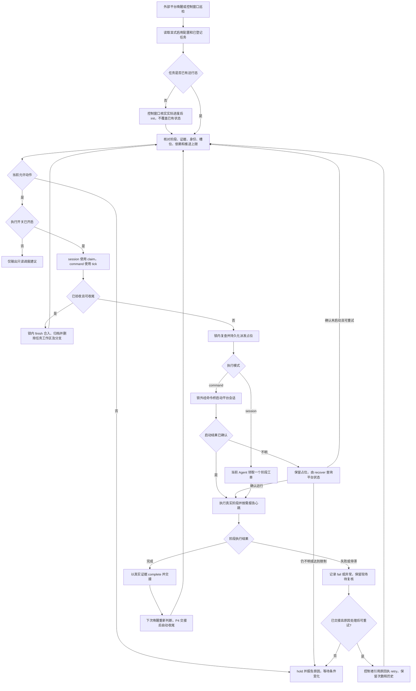

# axns-devflow 的可选自驱调度扩展

当前版本：`1.0.0-rc.9`（预发布）。版本来源为 [SKILL.md](SKILL.md) 的 `metadata.version`。

与 `axns-devflow` 同时安装；需要多任务隔离时再安装 `axns-devflow-ext-worktree`。需要 Node.js 和可用的 Git（worktree 模式）。安装后项目仍默认手动模式。

本版本包含只读判定脚本和默认关闭的通用执行层：session 模式供 DSH/Orca 已启动的自动化会话领取一个阶段；command 模式通过接入方的命令桥启动和查询会话。Orca 可生成禁用状态的自动化安装计划；本仓库没有实际安装平台定时任务。

## 工作流程

这项扩展调度已经登记并获授权的任务。默认关闭执行；开启执行后，缺省推进到 P4 并支持自动本地合入、归档、删除本任务 worktree/分支。已有配置中的显式 P3 或 finish_task:false 继续生效，需要调整才能采用完整闭环。



session 模式由 DSH / Orca 已启动的 Agent 领取工单；command 模式可选随附的直接 DSH 桥或 Orca 桥，也可接入其他可执行的启动与查询 JSON 命令桥。派发结果不明时通过 recover 核对，不能盲目重复启动。worktree 模式还需满足范围和修改权检查；显式人工验收阻塞只等待当前任务。

只读入口 autopilot.cjs 始终输出建议；执行与回调使用 runner.cjs。Orca 适配器目前生成禁用状态的安装计划，实际定时任务尚未安装；DSH 已提供直接 headless 进程桥和有限控制器，也可由 Orca 承载。原生上下文观测、成员场景路由与选型报告见 [执行方式选择](references/execution-modes.md)。接入方式见 [平台说明](references/platforms.md)，占位、回调与恢复细节见 [执行说明](references/execution.md)。

## 1. 显式启用

先按宿主初始化最低目录，在主检出目录 `AGENTS.md` 声明：

```yaml
extensions: [autopilot]
autopilot_config: _plan/prompts/autopilot.json
```

需要 worktree 时，改为：

```yaml
extensions: [worktree, autopilot]
integration_branch: main
lock_timeout_minutes: 120
autopilot_config: _plan/prompts/autopilot.json
```

支持上述单行列表及简单缩进列表。配置路径相对主检出目录，可以用引号包含空格；不支持完整 YAML、重复键或路径越界。技术栈、模型账号、项目授权和运行命令由项目维护。

在主检出目录 `.gitignore` 增加：

```gitignore
/_plan/autopilot/
```

worktree 的其他忽略项和旧单指针迁移要求仍按其 README 执行。不要把调度运行态提交到仓库或放进任务 worktree；后者会阻止 worktree 的干净结案检查。

## 2. 配置与首次巡检

建立 `_plan/prompts/autopilot.json`。建议先用只读配置：

```json
{
  "version": 1,
  "slots": 2,
  "capabilities": {
    "advance": { "enabled": false, "max_stage": "P4" },
    "switch_model": { "enabled": false },
    "open_window": { "enabled": false, "only_registered": true },
    "finish_task": { "enabled": false }
  }
}
```

```powershell
node "<扩展目录>/scripts/autopilot.cjs" status --project "<项目>"
node "<扩展目录>/scripts/autopilot.cjs" decide --project "<项目>"
```

输出始终为 JSON，`--json` 是兼容选项。未启用返回 `enabled: false`、退出码 0；错误为 1；没有可执行动作且存在需处理任务时为 2。任务失败、超时或升级只 hold 自身；独立任务仍可推进并退出 0。recovery_count 表示由 AI 先诊断恢复的异常，needs_human_count 仅表示需要用户决定或显式确认的任务。全局读取/配置/协调异常退出 1、不返回可执行建议。显式人工验收等待维持退出 0；blocking_human_count 为 0 表示没有整轮阻断项。

## 3. 接入一个已登记任务

任务仍按宿主 P1 登记；多任务必须经过 worktree 的 scope 和持权检查。本扩展不发现未来需求、不登记新任务。单任务读取 `_plan/.active_plan`；worktree 读取主检出目录的活动及归档指针。

控制窗口核实任务已有授权、计划及当前进度后，在主检出目录建立 `_plan/autopilot/<task-id>/stage.json`：

```json
{
  "task_id": "20261112-example",
  "stage": "P2",
  "state": "ready",
  "owner": "controller/example",
  "updated_at": "2026-11-12T15:00:00+08:00",
  "attempts": 0
}
```

以上日期、任务和阶段按实际替换。`ready` 表示等待执行当前阶段；`completed` 表示当前阶段已完成，须填写证据路径，并把 status 返回的 `head`、`worktree_snapshot` 分别写入 `completed_head`、`completed_worktree`（非 Git 的 head 为 null，内容快照仍必填）。完整规则见 [协议](references/protocol.md)，不要因看到文件就补写完成。

接好平台预留与恢复机制后，再把 `advance.enabled`、`open_window.enabled` 改为 `true`。最小建议模式可以只写 `{ "version": 1 }`，其默认上限为 P4、默认允许 worktree 收尾，实际执行仍关闭。没有模型表时沿用现有模型；选择模型前由平台验证可用性。

## 4. 执行与验收边界

runner 已实现 [协议的执行契约](references/protocol.md#执行平台契约) 中的原子占位、共享互斥、心跳、完成证据和故障恢复。平台启动的会话须消费 claim 工单并调用 callbacks；只定时运行 decide 仍只得到建议。

`finish_task` 对已验收且干净、已合入或可快进合入的 worktree 调用 `worktree.cjs finish --accepted-head <完整候选HEAD>`。人工验收独立使用主检出目录 `_plan/prompts/acceptance.json`，默认关闭；开启且非阻塞不等待人工确认，显式阻塞仅等待当前任务。真实确认使用独立 human_acceptance 回执；调用 finish 时附 --human-accepted-by。沿用用户任务授权完成本地收尾。任务窗口用 worktree commit 提交并真实验收，complete 传 --accepted-head 后交接；主目录的下一轮 claim/tick 自动调用 finish 完成快进合入、归档、删除任务 worktree 与本地分支，保留证据和运行回执。显式禁止或等待要求继续有效。

## 5. 开启一个阶段的自动执行

核实已登记任务和当前实际阶段后，使用以下最小执行配置（默认最高 P4、支持 worktree 自动结案）：

```json
{ "version": 1, "execution": { "enabled": true, "adapter": "session" } }
```

```powershell
node "<扩展目录>/scripts/runner.cjs" init --project "<项目>" --id "<已登记task-id>" --stage P2 --owner "controller/setup"
node "<扩展目录>/scripts/runner.cjs" claim --project "<项目>"
```

init 仅用于尚无运行态的任务，已有 stage.json/window.json 时拒绝覆盖。claim 返回 finished 时本轮已结案；返回 request 时包含 request.cwd、宿主阶段提示词和字面参数形式的 callbacks；自动化 Agent 依工单执行真实阶段，以非空证据调用 complete/fail 并交接。之后再次唤醒才能领取下一阶段，P4 完成后由主目录下一轮自动收尾。

具体回调、退出码和中断恢复见 [执行与恢复](references/execution.md)。DSH、Orca 的原生清单分工、唤醒提示词和 PyCharm 协作见 [平台接入](references/platforms.md)。模型路由配置存在时必须确认会话实际模型；不能靠配置文本在当前会话切换模型。

失败阶段通过带原 dispatch 和处理依据的 `runner.cjs retry` 恢复，保留失败次数及历史；达到 max_attempts 时停止，不自动重置。非 Git 项目完成回执覆盖整个项目目录（仅排除 `_plan/autopilot/`），项目内容变化使旧证据失效。

字段默认值见 [配置](references/config.md)。行为测试为 tests/autopilot.test.cjs 与 tests/autopilot-runner.test.cjs；后者使用隔离临时项目和模拟平台桥，不代表真实平台联调。

## 版本管理与记录

本技能独立维护版本。每个后续变更批次同步更新 `SKILL.md` 的 `metadata.version`、本页当前版本和下表；最新记录置顶，保留历史。记录日期、具体改动和验证结果，涉及不兼容变更时补充迁移说明。

预发布按 `1.0.0-rc.1 → 1.0.0-rc.2` 递增，通过相应验证后可发布 `1.0.0`。正式版修复递增 PATCH，兼容新增递增 MINOR，不兼容变更递增 MAJOR；下一轮预发布使用目标版本加 `-rc.1`。仅修改本技能时，无需连带升级其他技能。

| 版本 | 日期 | 变更记录 | 验证与状态 |
| --- | --- | --- | --- |
| `1.0.0-rc.9` | 2026-11-23 | 模型配置前置、图像识别归入设置、预设联动统一保存、不关联只读及模型能力匹配；新增模板更新检查、补齐/选择同步、提示词复制与下载，同步基线与配置事务保存。 | 模型页面/配置/模板 54 项及初始化 7 项回归通过；浏览器验证桌面、窄屏、补齐、逐项同步、保存重载及提示词复制/下载。全仓首轮的 3 项初始化链接失败已修复并定向复跑通过；未整套重跑、发布或同步安装。 |
| `1.0.0-rc.8` | 2026-11-23 | 项目设置使用带说明的单选项。集成分支读取本地 Git 分支。应用方式可对比适用场景、方式说明和场景分工，默认任务模型显示实际模型 ID。 | 58 项定向回归通过，本机桌面及窄屏窗口通过选择、说明编辑和保存重载复验。 |
| `1.0.0-rc.7` | 2026-11-23 | 配置中心按项目、模型、场景、阶段、JSON 分区，固定导航与保存，模型/场景搜索及宽行详情；输入不重建表格，ID 重命名恢复焦点；窄屏左侧标签逐项编辑。 | 定向回归 56/56；Orca 本机 1280×800、1024×768、390×844 窗口及点击、Tab、筛选、独立保存与重新加载复验通过；未发布或同步安装。 |
| `1.0.0-rc.6` | 2026-11-23 | 配置中心采用左侧标签和分组布局，模型表前置，名称/ID 分列并维护引用，新增视觉能力元数据、展开的阶段卡片和可编辑应用方式；DSH 原生 worktree 独立开关与新版 Team 配置兼容；保存开发设置保留模型草稿。 | 全仓 npm run validate：256 项、255 通过、1 跳过、0 失败（493.25 秒）；定向回归 56/56；本机 DSH 四组合配置合成通过，浏览器桌面/窄屏与保存往返通过；真实模型会话未执行，未发布或同步安装。 |
| `1.0.0-rc.5` | 2026-11-22 | DSH worker 在项目校验前持久化进程状态；对共享锁/观察变化进行有界启动重试，并将启动失败记录为 stopped，避免控制器把已退出 worker 长时间当作 starting。回调瞬态重试预算延长至 20 秒。 | npm run validate：250 项，249 通过、1 跳过；DSH direct/controller 与锁竞争回归通过。测试耗时 523.8 秒；真实平台未复验，未发布或同步安装。 |
| `1.0.0-rc.4` | 2026-11-22 | 明确事实复用失效条件、失败/未知启动/等待处理及兼容窄视图；严格短工单改为显式启用，不作为通用换窗要求。 | autopilot/runner/model-config 定向回归 80/80 通过；真实平台未复验，未发布或同步安装。 |
| `1.0.0-rc.3` | 2026-11-22 | 配置页提供项目模式设置、worktree/autopilot 显式声明、自动执行配置、可选工作区模式-模型预设关联；打开页面不写入配置或创建模型表。 | 相关回归 78/78 通过；模型页最终复跑 18/18、初始化 7/7 通过；全仓及真实平台尚未验证，未发布或同步安装。 |
| `1.0.0-rc.2` | 2026-11-21 | 兼容新增运行态、决策和模型表窄视图；减轻已派发执行者的重复读取与步骤回报，保持回调门禁。 | 全仓 244 项：242 通过、1 跳过、1 项直接 DSH 模拟没有返回预期 `stage_cap`；整份直接 DSH 测试单独复跑 6/6 通过。真实平台未复验，未发布或同步安装。 |
| `1.0.0-rc.1` | 2026-11-17 | 建立调度扩展的版本基线，包含任务巡检、可选执行、互斥领取与证据回调。统一版本字段及 README 版本记录。 | 本地源码基线；版本一致性及源码快照检查通过，尚未发布或同步安装。 |


## 纯 DSH 与 Orca 如何选择

[执行方式与模型场景](references/execution-modes.md) 提供直接 DSH 自动接续、Orca 可选承载、单文件成员场景配置、原生推理强度限制与运行期上下文计量。使用 `scripts/execution-guide.cjs` 生成离线交互报告，可按实际需求对照两条路径。直接 DSH 创建后台 headless 新会话，当前不自动替换 Desktop 可见标签；程序验证与真实模型业务推理分别记录。


项目配置页：先进入目标项目目录，再运行 `node <扩展目录>/scripts/model-page.cjs`。页面以当前目录识别项目，不使用 `--project-root`。打开页面只读；可显式保存项目声明、单工作区/worktree 选项、autopilot execution 配置和可选的工作区模式-模型预设关联。项目设置与模型表统一保存；关联预设在各分区同步，保存后用于新会话。启用 execution 需单独勾选并二次确认；保存不会创建任务或派发。适配器状态不代表账号或真实平台已验证。项目模型表初始化由宿主Devflow提供。


## 使用端跟进技能与模板更新

更新技能后，从新版扩展目录启动配置页，点击工具栏的“检查模板更新”。支持常用模板与通用模板、差异分类、补齐全部缺失项及逐项选择同步。只读检查和应用到草稿均不会直接写入项目，点击现有保存按钮后，模型、项目设置及 `.devflow/model-template.json` 同步记录一并保存；失败回滚。

首次没有历史基线时，已有值不同标为冲突，默认保留。记录检查结果后，后续检查可区分模板变化与项目自定义；项目主动删除的旧字段不会被“补齐缺失项”恢复。模板移除项和活动预设始终保留，切换模板来源会重新按无基线规则比较。内容指纹用于识别模板变化，技能版本单独展示，模型表无需增加迁移字段。项目规范和阶段提示词仍按实际差异有界合并。

工具栏的“升级提示词”支持复制和下载。提示词随宿主技能分发于 `prompts/project-upgrade.md`。需要保全未保存草稿后重启旧服务，避免继续使用旧页面。更新只影响后续新会话，不改写既有工单快照，也不自动启用执行开关。

此更新入口需要同时更新 `axns-devflow >= 1.0.0-rc.7` 与 `axns-devflow-ext-autopilot >= 1.0.0-rc.9`。项目初始化/补齐会提供 `_plan/prompts/project-upgrade.md`，已有提示词保留原内容。
