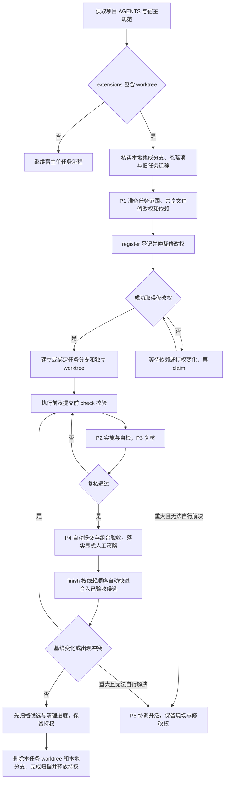

# axns-devflow 的可选 worktree 扩展

当前版本：`1.0.0-rc.2`（预发布）。版本来源为 [SKILL.md](SKILL.md) 的 `metadata.version`。

安装时同时选择 `axns-devflow`、`axns-devflow-ext-worktree`。安装扩展不等于启用；项目仍默认单任务模式。

## 工作流程

扩展在同一仓库的本机 worktree 之间协调任务；宿主的 P1–P4 仍负责开发与验收。AI 在用户任务授权内连续推进，commit 校验范围后提交，finish 将已验收候选快进合入、归档并删除本任务 worktree 和本地分支。

### 创建与复用规则

任务先定义有界目标与完成标准；持续收集需求也按批次交付，后续独立需求进入新任务。新编号例如 `261117-A01-weknora-mcp-config`，默认 A 新增、M 修改、F 修复、R 复核；优先沿用项目已声明的类型，不按模块无限增码。使用 `register --type A --title weknora-mcp-config --manifest "<JSON>" --project "<项目>"` 可在共享锁内分配本地日期及下一序号；格式、项目类型表与旧编号兼容见 [协议](references/protocol.md)。

每个**独立登记的开发任务**在 P1 创建一个对应 worktree，且在该任务首次业务代码修改前完成登记。一个任务的 P2 实施、P3 复核、返修、P4 验收以及跨会话接续都留在同一 worktree；阶段或会话切换不另建工作区。结案清理后，下一个独立任务必须使用新 task-id 登记并创建新 worktree，不接管前一个已结案任务的目录或分支。

`autopilot.slots` 控制并行窗口上限，不限制任务生命周期内可先后创建的 worktree 总数。比如两个窗口运行任务 A、B，A 结案并释放后，仍可登记任务 C 并继续在 B、C 上执行。自动调度只处理已登记任务，不会自动把待办逐条转换成任务。按业务交付和依赖拆分任务，避免把一个闭环拆成大量碎片，也不要把多个独立目标长期塞进少数长期任务。



阻塞式人工验收只等待当前任务；验收和授权条件未满足时不能继续结案。基线变化或冲突应回到任务分支重新验证；finish 负责核验、快进合入与可恢复收尾，实际检查仍由 AI 执行并留证。普通故障自行修复，不因超时或重复失败直接转交用户。doctor 仅做只读排查，不能替代执行前的 check。

项目已有宿主最低目录后，在 AGENTS.md 声明：

```yaml
extensions: [worktree]
integration_branch: main
lock_timeout_minutes: 120
```

`main` 换成项目真实本地集成分支。多行 `extensions` 列表也支持；这些字段各自独占一行，使用上面的明确配置形式。AGENTS.md 是唯一开关源，技能安装状态和提及 worktree 的自然语言都不会启用扩展。

在项目 `.gitignore` 中加入以下**本地协调文件**，按项目授权将配置提交到集成分支，再开任务：

```gitignore
/.worktrees/
/_plan/active/
/_plan/archive/
/_plan/registry.jsonl
```

已有非空 `_plan/.active_plan` 时先完成原任务，或明确迁移旧任务并归档单指针。不要在执行中的单任务上直接切换模式。

每个新窗口贴宿主 P0，再按 P1–P4 推进；P5 仅协调升级时使用。宿主初始化会把提示词放在项目 `_plan/prompts/window/`。检查活动任务：

```powershell
node "<扩展技能目录>/scripts/worktree.cjs" status --project "<项目目录>"
# 协调锁被占用或怀疑登记异常时，只读排查
node "<扩展技能目录>/scripts/worktree.cjs" doctor --project "<项目目录>"
```

登记清单、完整命令、范围语法、组合验收和恢复方式见 [协议](references/protocol.md)。范围和共享持权检查已经实现，不是仅告警模式。脚本不安装 hook 或替代项目检查；AI 运行真实验证后通过 commit / finish 自动收尾。中断后用相同 task-id 和 accepted-head 重试 finish；已完成任务幂等返回，不重复删除。跨窗口协调仅覆盖同一台机器、同一 Git 仓库的 worktree，独立 clone 或其他成员机器需要另行协调。

`doctor` 展示 Git 实际清单、锁原因、prunable 登记、任务身份/元数据异常，以及协调锁的进程信息。它不取锁、不改登记，输出不是事务快照；诊断结果不能替代执行前 `check`。新 worktree 的依赖安装、环境准备和缓存清理由项目基线约定。设计来源和适用边界见 [Orca 对照记录](references/orca-comparison.md)。

## 编程器与 IDE 协作

DSH/Orca 的原生自动化和清单继续使用；启用本扩展后由本扩展统一登记工作区及共享修改权，Orca 和 PyCharm 打开已登记目录。平台自身的 worktree 创建功能不同时为同一任务再建工作区。跨平台执行权交接与清单分工见 [工具协作](../axns-devflow/references/tool-integration.md)。

默认自动收尾仅覆盖本任务的本地资源。已显式关闭的 autopilot 能力继续生效；要启用跨会话闭环，配置 `advance.max_stage: P4`、`finish_task.enabled: true` 和 `execution.enabled: true`。P4 窗口回调交接后，下一轮主目录的 claim/tick 执行收尾。

## 版本管理与记录

本技能独立维护版本。每个后续变更批次同步更新 `SKILL.md` 的 `metadata.version`、本页当前版本和下表；最新记录置顶，保留历史。记录日期、具体改动和验证结果，涉及不兼容变更时补充迁移说明。

预发布按 `1.0.0-rc.1 → 1.0.0-rc.2` 递增，通过相应验证后可发布 `1.0.0`。正式版修复递增 PATCH，兼容新增递增 MINOR，不兼容变更递增 MAJOR；下一轮预发布使用目标版本加 `-rc.1`。仅修改本技能时，无需连带升级其他技能。

| 版本 | 日期 | 变更记录 | 验证与状态 |
| --- | --- | --- | --- |
| `1.0.0-rc.2` | 2026-11-21 | 兼容新增状态摘要、带持权检查的项目模型表维护、独立候选快照；见[使用与恢复](references/maintenance.md)。 | 临时 Git 的维护冲突、版本检查、快照恢复和原隔离/合入门禁回归通过；未在原项目复验、未发布或同步安装。 |
| `1.0.0-rc.1` | 2026-11-17 | 建立工作区扩展的版本基线，包含有界任务、类型命名、验收合入与工作区释放。统一版本字段及 README 版本记录。 | 本地源码基线；版本一致性及源码快照检查通过，尚未发布或同步安装。 |
