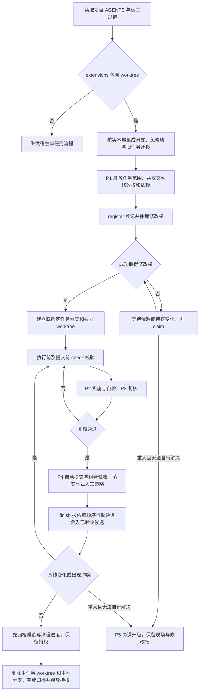

# axns-devflow 的可选 worktree 扩展

安装时同时选择 `axns-devflow`、`axns-devflow-ext-worktree`。安装扩展不等于启用；项目仍默认单任务模式。

## 工作流程

扩展在同一仓库的本机 worktree 之间协调任务；宿主的 P1–P4 仍负责开发与验收。AI 在用户任务授权内连续推进，commit 校验范围后提交，finish 将已验收候选快进合入、归档并删除本任务 worktree 和本地分支。



阻塞式人工验收只等待当前任务；验收和授权条件未满足时不能继续结案。基线变化或冲突应回到任务分支重新验证；finish 负责核验、快进合入与可恢复收尾，实际检查仍由 AI 执行并留证。普通故障自行修复，不因超时或重复失败直接转交用户。doctor 仅做只读排查，不能替代执行前的 check。

项目已有宿主最低目录后，在 AGENTS.md 声明：

```yaml
extensions: [worktree]
integration_branch: main
lock_timeout_minutes: 120
```

`main` 换成项目真实本地集成分支。多行 `extensions` 列表也支持；这些字段各自独占一行，使用上面的明确配置形式。AGENTS.md 是唯一开关源，技能安装状态和提及 worktree 的自然语言都不会启用扩展。

在项目 `.gitignore` 中加入以下**本地协调文件**，按项目授权将配置提交到集成分支，再开任务：

```gitignore
/.worktrees/
/_plan/active/
/_plan/archive/
/_plan/registry.jsonl
```

已有非空 `_plan/.active_plan` 时先完成原任务，或明确迁移旧任务并归档单指针。不要在执行中的单任务上直接切换模式。

每个新窗口贴宿主 P0，再按 P1–P4 推进；P5 仅协调升级时使用。宿主初始化会把提示词放在项目 `_plan/prompts/window/`。检查活动任务：

```powershell
node "<扩展技能目录>/scripts/worktree.cjs" status --project "<项目目录>"
# 协调锁被占用或怀疑登记异常时，只读排查
node "<扩展技能目录>/scripts/worktree.cjs" doctor --project "<项目目录>"
```

登记清单、完整命令、范围语法、组合验收和恢复方式见 [协议](references/protocol.md)。范围和共享持权检查已经实现，不是仅告警模式。脚本不安装 hook 或替代项目检查；AI 运行真实验证后通过 commit / finish 自动收尾。中断后用相同 task-id 和 accepted-head 重试 finish；已完成任务幂等返回，不重复删除。跨窗口协调仅覆盖同一台机器、同一 Git 仓库的 worktree，独立 clone 或其他成员机器需要另行协调。

`doctor` 展示 Git 实际清单、锁原因、prunable 登记、任务身份/元数据异常，以及协调锁的进程信息。它不取锁、不改登记，输出不是事务快照；诊断结果不能替代执行前 `check`。新 worktree 的依赖安装、环境准备和缓存清理由项目基线约定。设计来源和适用边界见 [Orca 对照记录](references/orca-comparison.md)。

## 编程器与 IDE 协作

DSH/Orca 的原生自动化和清单继续使用；启用本扩展后由本扩展统一登记工作区及共享修改权，Orca 和 PyCharm 打开已登记目录。平台自身的 worktree 创建功能不同时为同一任务再建工作区。跨平台执行权交接与清单分工见 [工具协作](../axns-devflow/references/tool-integration.md)。

默认自动收尾仅覆盖本任务的本地资源。已显式关闭的 autopilot 能力继续生效；要启用跨会话闭环，配置 `advance.max_stage: P4`、`finish_task.enabled: true` 和 `execution.enabled: true`。P4 窗口回调交接后，下一轮主目录的 claim/tick 执行收尾。
