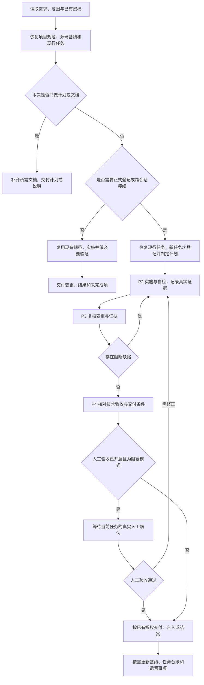
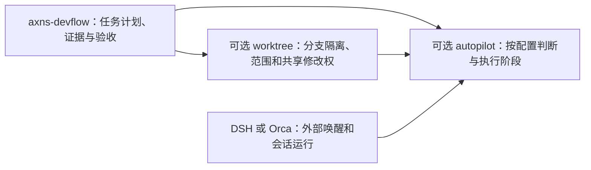

# 通用开发工作流：使用说明

用于个人在不同技术栈项目中快速建立开发流程，也支持接续现有项目。流程目录统一，业务架构和命令按项目事实确定。

## 工作流程

宿主负责计划、实施证据、复核与交付。阶段按任务规模组织，已有执行授权继续有效；只有用户要求先汇报等待或缺少必要决定时才暂停受影响动作。普通小修改可直接实施、验证并交付。



人工验收默认关闭；开启且非阻塞时继续交付并保留待验收项。合入和提交仍需任务已有授权，启用技能本身不授予这些权限。P5 用于已启用扩展中的协调升级，不是每项任务的固定阶段。

宿主与扩展的分工如下：



未启用扩展时按宿主单任务流程运行。worktree 和 autopilot 可分别启用，也可叠加；具体流程见 [worktree](../axns-devflow-ext-worktree/README.md) 与 [autopilot](../axns-devflow-ext-autopilot/README.md)。

## 日常怎样使用

| 当前工作 | 直接采用的方式 |
| --- | --- |
| 改文案、修单点缺陷、调整小功能 | 说明目标后直接实施和验证；结果可写在回复中，不要求初始化或正式登记 |
| 跨模块开发、需要多轮接续 | 复用唯一计划，记录必要证据，从当前阶段继续 |
| 新项目需要统一流程 | 初始化完整目录和导航，再按实际任务填写内容 |
| 已有原生自动化或任务清单 | 复用 DSH/Orca；需要跨会话领取才启用 autopilot，需要并行隔离才启用 worktree |

```text
使用 $axns-devflow，完成〈具体目标〉并做必要验证。沿用已有项目规范和授权，按任务规模保留记录。遇到真正阻断的问题说明依据，继续其余可做部分。
```

会话可以复用，一轮只执行一个任务。接续新任务时重新核实任务身份、工作目录、分支及授权；自动化派发还需重新领取执行权。

## 新项目快速建立流程

新项目至少建立规定的完整 `_doc`、`_plan` 目录骨架，每个子目录有用途 README；目录定义及维护边界见 [最低结构与初始化](references/project-layout.md)。

在 Agent 中打开目标项目后可直接使用：

```text
使用 $axns-devflow，在当前项目初始化开发流程。
按技能规定创建完整 _doc、_plan 最低目录骨架及 README、flow.md，生成项目基线、阶段指南、任务模板和可复制提示词。保留已有文件与现行规范，按真实情况填写已知内容，未知项标记待核实。
本次产品目标：〈目标〉。本次只建立流程文档，业务开发将在后续任务中进行。
```

也可用本技能自带脚本一次建立；需要 Node.js，无第三方依赖。在任意目录执行，替换技能目录、项目路径及名称：

```powershell
node "<技能目录>/scripts/init-workflow.cjs" --project-root "<项目路径>" --project-name "<项目名称>"
```

加 `--dry-run` 可预览；重复执行只补缺失文件，已有文件逐字保留。初始化后先核实 `_plan/prompts/project.md`，再从 `_plan/prompts/stages.md` 选择本次阶段，真实任务放进 `_plan/process/`。没有 Node.js 时 Agent 可按模板手工生成相同结构。

## 进入开发

```text
使用 $axns-devflow，读取当前项目 _plan/README.md、_plan/prompts/project.md 及相关源码，完成以下已授权的开发与验证。
需求：〈目标、预期行为与范围〉。
恢复唯一现行计划和已有工作，按任务规模记录真实变更、验证结果、未覆盖边界及下一步。
```

完整阶段指令见 [提示词集](references/prompt-kit.md)，执行规则见 [SKILL.md](SKILL.md)。已有项目先读取现行规范和任务记录；只有需要建立或补齐流程时才增量处理，不把补齐目录作为普通修改的前置。

## 项目技术约定

具体技术栈、架构、UI、API 和发布策略写入目标项目的 `_plan/prompts/project.md` 与 `_plan/guides/`，按任务读取。生成项目流程时从源码、依赖、配置和现行规范填写实际事实；未知项标明待核实。技能更新不会自动改写已生成的项目文档。

本仓库另提供 [Python + Vue 3 + Tauri 可选项目模板](../../templates/python-vue3-tauri/README.md)，供已采用该技术栈的项目选用。模板独立于技能分发；只安装技能的用户可从仓库获取模板，也可直接让 Agent 依据项目事实生成规范。已有基线按段合并，避免创建第二份。

## 正式任务、会话接续与可选 worktree

窗口指令从 [P0 开窗](prompts/window/P0-open.md) 开始；P1 登记 → P2 执行 → P3 复核 → P4 验收与合入。初始化会生成 `_plan/prompts/window/P0–P5`，更新旧项目时仍只补缺失文件，已有指南需要按需增量整合。P0 回报后按已有授权继续，用户要求先汇报等待时才保留该边界；已有任务从实际阶段接续。P5 仅扩展启用时使用。

默认单任务，P1 写 `_plan/.active_plan`，任务放 `_plan/process/<task-id>/`。要隔离多个任务窗口，同时安装 axns-devflow-ext-worktree，并在目标项目 AGENTS.md 声明 `extensions: [worktree]`、实际 `integration_branch` 及可选超时，再按扩展 README 配置忽略项。扩展登记/检查工具会校验范围和修改权，跨窗口共用主检出目录的状态；已授权任务由 AI 调用 commit / finish 完成提交、本地合入、归档与资源清理。

任务结案或完成执行权交接后可以复用会话，重新核实新任务的登记、目录和持权。技术栈规则仍由项目维护，不因 worktree 扩展而改变。

可选自驱调度见 [axns-devflow-ext-autopilot](../axns-devflow-ext-autopilot/README.md)：项目显式声明 `extensions` 包含 `autopilot` 并指定配置路径后，可读取已登记任务给出只读建议；显式开启执行层后，可由现有会话领取阶段工单，或通过命令桥派发会话。定时唤醒与真实平台连接由接入方配置。它可与 worktree 叠加，也支持有效槽位为 1 的单任务模式，不增加技术栈约定或合入授权。

人工验收策略独立保存在 `_plan/prompts/acceptance.json`，初始化默认关闭；开启且非阻塞时继续自动交付，只在显式阻塞模式等待当前任务的确认。详见 [人工验收配置](references/acceptance.md)。

## DSH、Orca 与 PyCharm 配合

DSH/Orca 原生自动化负责唤醒，原生任务清单负责当前步骤；devflow 保存跨会话的项目计划、证据和验收。PyCharm 打开同一任务目录用于编辑与调试。按需启用 autopilot 和 worktree，同一任务保持一个执行权与主要唤醒入口。完整分工、流程图、平台切换及官方依据见 [工具协作](references/tool-integration.md)。无需新增调度插件。
