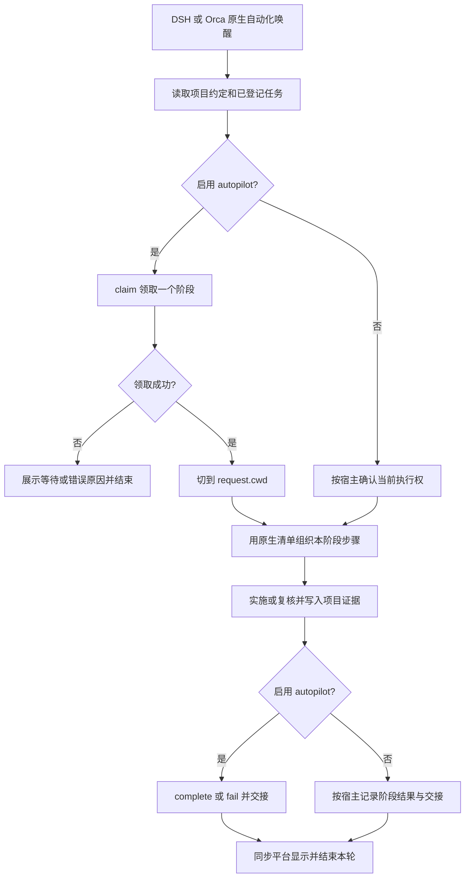

# DSH、Orca 与 PyCharm 协作

优先复用 AI 编程器自带的自动化与任务清单。本基线提供跨工具保留的计划、证据和交接规则；无需为接入再安装一个调度插件。单会话手工开发只用宿主即可，需要跨会话领取与回调时启用 autopilot，需要并行任务隔离时再启用 worktree。

## 职责与唯一入口

| 内容 | 维护位置与责任 |
| --- | --- |
| 定时、唤醒、模型配置、会话运行历史 | DSH 或 Orca 原生自动化；同一项目选定一个主要唤醒入口 |
| 当前会话的执行步骤 | 编程器原生 Todo / 清单；正式任务沿用项目 task-id，轻量任务按需求组织即可 |
| 任务范围、成功标准、计划变更 | 正式任务使用项目 `_plan/process/<task-id>/` 的现有计划；轻量任务复用现有载体，无需为清单另建计划 |
| 自检、复核、技术交付与人工确认 | 原任务证据和验收记录；平台运行成功、Todo 完成不替代验收 |
| 跨会话派发、互斥、回调 | 已启用时由 autopilot runner 维护；未启用时按宿主交接规则执行 |
| 并行工作区、scope 与共享修改权 | 已启用时统一由 worktree 扩展维护；平台打开已登记目录 |
| 编辑、断点、终端与差异复核 | 可在 PyCharm 中进行；使用同一任务目录、解释器和分支 |

原生清单可以承载细化步骤；涉及目标、范围、方案或验证方法的实质变化，先更新项目计划。无需逐条复制清单历史到 Markdown，小任务可直接用需求、原生清单和交付回复，不为清单强制创建 task-id 或计划目录；使用 autopilot/worktree 时才按其协议登记。跨会话恢复从项目任务记录取得事实，再恢复当前阶段清单。

## DSH：自动化规则、Todo 与开发任务

此处 DSH 指 DeepSeek Harness。官方 Schedule 指南描述宿主自动化任务页面与向现有/新对话投递指令；Todo 文档描述每个 Agent 会话的一份步骤清单。两者与项目开发 task-id 各有用途：自动化规则可以重复唤醒多个阶段，Todo 表示当前会话步骤，项目任务跨会话保留成功标准和证据。

- 自动化指令使用 `axns-devflow-ext-autopilot` 的 session 接入约定，在每次唤醒后领取工单；提醒投递记录只证明指令已投递。
- 在 Todo 文本中保留 `[task-id / P2 / R1]` 等关联信息。已核对的 Todo 结构只有 content 和 pending / in_progress / completed，且整体替换列表，不依赖不存在的稳定条目 ID。
- 进入下一对话时先恢复项目事实，再重建本阶段 Todo；不把前一会话清单当作项目登记、依赖或验收事实。
- 规则投递到新对话时核实工作目录、preset 和可用工具。规则暂停只停止后续唤醒，已运行派发仍须按 runner 完成或中断交接。

## Orca：现有工作区与任务关联

Orca 任务入口可继续关联原有 issue/任务；在描述或会话上下文中记录项目 task-id、阶段和项目记录路径。原生自动化使用已有 workspace 作为入口，领取后切到 request.cwd。Orca 自身还可以启动 DSH 会话；这种组合记录为“Orca 唤醒、DSH 执行”，不再为同一任务另开一条 DSH 定时规则。

启用 devflow worktree 时，让 Orca 打开登记好的任务目录，不再为同一任务自动创建嵌套 worktree。已有 Orca worktree 需先按扩展登记要求整理路径与分支，不能仅凭平台工作区存在就视为已持权。未启用该扩展时，沿用原生工作区管理，不添加本扩展登记。

创建自动化先生成禁用计划并核对 workspace/provider；默认每次运行领取一个阶段，完成交接后结束。Orca 的手动 Run now 会绕过其 precheck，因此实际执行始终由 claim 重新判定。同一会话可在上一任务结案或完成执行权交接后接续新任务；重新读取任务身份、工作目录、分支及授权，领取新 owner / dispatch，不用旧回调操作新任务。P0 核实后沿用已有执行授权；只有用户要求本次回报后等待或缺少必要决定时才等待。外部 issue 何时关闭按项目交付约定执行，单阶段 Todo 完成不自动关闭整个开发任务。

## PyCharm：同一目录与执行权

PyCharm 用于阅读、编辑、调试或接手当前阶段。打开 request.cwd（多任务时为任务 worktree），核对分支和项目解释器；终端及运行配置的工作目录也指向此处。需要时通过 External Tools 配置 `autopilot.cjs` 的只读 `status` / `decide`，Program 指向本机 Node，Arguments 使用绝对脚本路径，Working directory 指向项目；不把自动 save/build 钩子绑定到 claim/complete。

- AI 阶段运行期间，人工修改同一目录前先协调该阶段的执行权；只打开或查看差异无需交接。
- 接手运行中的派发须先核实原会话；未知存活状态保留窗口，已确认停止则 interrupt，复核后 retry。心跳过期不足以证明停止。
- 在 complete 前完成会改变项目文件的保存、格式化和生成动作；之后任何源码或证据变化都需按实际影响重新验证。非 Git 项目会指纹整个目录（仅排除 `_plan/autopilot/`），IDE 配置和本地输出变化同样会使旧记录失效；频繁生成内容的项目优先用 Git 管理受检文件范围。

## 自动收尾

启用 worktree 的已授权任务由 AI 连续提交、组合验证、本地合入、归档和删除本任务工作区/分支。DSH/Orca 的自动化入口固定在主检出目录；领取阶段才切入 request.cwd。P4 complete --accepted-head 后交接，下一次主目录 claim/tick 自动收尾。原生 Todo 可记录“验证与收尾”一步，无需为每次 Git 操作再确认。

收尾前释放本任务终端、运行器和文件占用；AI 能处理的进程与缓存自行处理。PyCharm 不应继续向待删除目录自动保存，目录释放后打开主检出目录阅读已合入成果。冲突或基线前移先自行解决并复验，只有重大且无法安全解决的问题才请求用户介入。归档保留任务证据和最终提交身份，远程发布另按授权。

## 平台切换与最小关联信息

在现有任务卡中按需记录：`task-id`、平台任务/issue 链接、自动化规则与执行平台、当前阶段、工作目录、项目计划入口。启用 runner 后，派发身份以返回的 owner / dispatch_id 为准，平台 session-id 单独记录，不互相替代。原生 Todo 没有链接或稳定 ID 时，用内容文字保留关联即可。

从 DSH 切到 Orca（或反向）时先结束原派发并暂停原唤醒入口，再由新入口领取；清单展示延迟不授权第二次执行。领取失败先展示具体原因，不自行删锁、清空失败次数或篡改 ready。runner 只保证阶段占位，无法阻止绕过协议的手工写入。

## 核对依据

核对日期 2026-11-13；下列源码文档证明可接入能力，不代表本仓库已经完成真实平台联调。

- DSH `e8f7b93a344964de3dca1ace9e72b6e4d6de87cb`：[Schedule 指南](https://github.com/deepseek-ai/deepseek-harness/blob/e8f7b93a344964de3dca1ace9e72b6e4d6de87cb/docs/user/guide/schedule.zh.md)、[Todo 契约](https://github.com/deepseek-ai/deepseek-harness/blob/e8f7b93a344964de3dca1ace9e72b6e4d6de87cb/docs/subsystems/todo.zh.md)。
- Orca `69dc20ed337c515ee27a6021f21eb573ea5d5b79`：[自动化 CLI](https://github.com/stablyai/orca/blob/69dc20ed337c515ee27a6021f21eb573ea5d5b79/docs/site/content/docs/cli/automations.mdx)、[任务入口及 DSH 支持](https://github.com/stablyai/orca/blob/69dc20ed337c515ee27a6021f21eb573ea5d5b79/README.md)。
- PyCharm：[External Tools 官方说明](https://www.jetbrains.com/help/pycharm/configuring-third-party-tools.html)。
