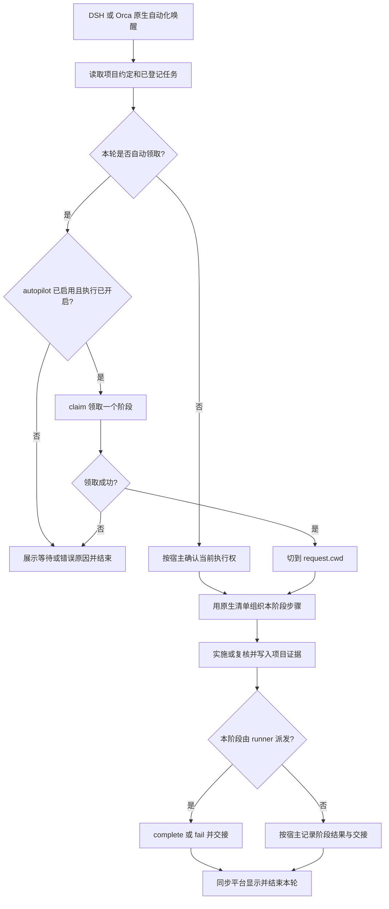

# DSH、Orca 与 PyCharm 协作

优先复用 AI 编程器自带的自动化与任务清单。本基线提供跨工具保留的计划、证据和交接规则；无需向业务工程集成运行库。使用流程不要求重构业务代码、重写项目或初始化完整目录。

## 采用程度与启用边界

| 本次需要 | 应做的事 | 所需配置 |
| --- | --- | --- |
| 使用规范完成 README、小修改等任务 | 在当前已授权平台执行，沿用现有记录或交付说明 | 无需项目改造或扩展开关 |
| 多轮接续、在 DSH 与 Orca 间手动交接 | 共用 task-id、唯一计划和证据，明确当前执行方与下一动作 | 复用现有记录；缺少时只补必要文档，无需 autopilot |
| 自动领取阶段、互斥派发、状态回调 | 按 autopilot 协议登记任务、领取和回调 | AGENTS.md 启用 autopilot、execution.enabled=true，以及已核实的平台唤醒/执行入口 |
| 按 devflow 协议隔离多个任务工作区 | 按 worktree 协议登记工作区、范围与执行权 | AGENTS.md 启用 worktree；可与 autopilot 分别使用 |

轻量记录可采用以下结构，也可映射到项目已有载体；不为补齐完整骨架扩大任务范围：

```text
_plan/
├── ledger/tasks.md
└── process/<task-id>/
    ├── plan.md
    └── evidence.md
```

tasks.md 只维护索引和当前状态，目标、范围和证据以原任务记录为准。沿用项目已有编号；TASK-001 仅是示例，不要求改号。进入正式登记或扩展执行时，再遵循对应协议，不把这份文档结构当作运行登记。

同一 task-id 只关联记录，不会自动同步状态、获得执行锁、派发 Agent 或证明任务完成。手动交接也能跨会话恢复；只有确需自动领取和回调才启用 autopilot。仅安装技能或声明 extensions 不会自动创建平台定时任务；status/decide 是只读建议，执行入口与回调须另行核实。

执行平台遵循用户已有安排。例如项目约定“DSH 直接执行，Orca 仅在明确派发时使用”，就按该约定执行；不把这一项目策略设为所有项目的默认规则，也不因启用扩展自动派生代理。

## 执行端能力核实与降级

在计划派发或切换工具前，核实当前环境的实际调用条件，结果只记入原任务状态，不另建平台台账：

1. 确认 DSH/Orca 的实际安装与可访问入口。按环境使用命令发现（如 PowerShell `Get-Command`）、已暴露连接器/CLI 或配置路径，不凭技能已安装推断执行端已安装。
2. 用相应工具的只读帮助/状态入口核实版本、连接或登录状态、仓库访问、会话/模型可用性和所需并发能力。具体命令取其已安装版本的帮助或技能说明，不猜测可执行文件名和参数。
3. 分别记录“可用、已安装但当前不可调用、未安装、尚未核实”及依据。仅 CLI 存在、配置中写了模型、上一次调用成功，均不能证明本次能开窗。
4. 有可用且已授权的执行端就使用其工具链。缺少可选平台时，当前可用 Agent 可直接完成已授权任务并保留同一 task-id/证据，手动交接不要求安装另一平台或启用 autopilot。不要为流程自行下载安装、修改全局配置或伪造派发成功。
5. 若用户要求指定平台、独立复核或真实并行，能力缺口保留为待执行；继续不依赖它的工作，不把同窗口自查当成独立复核。启动结果不明先核实会话及领取状态再重试，避免重复写入者。

平台约束与上下文接续见 [上下文预算与交接](context-handoff.md)。扩展开关、工具安装、实际可调用以及用户授权分别判断，不能互相替代。

## 职责与唯一入口

主协调入口负责总目标、依赖、派发、整合和收尾，不靠 master/main 名称授予权限；实际集成分支和基线按已确认配置绑定。工单绑定执行角色、目录、被检身份、范围和必要输入，执行者不重做登记或全局调查。只读协作使用指定目录；已有合法隔离现场先复用。

调用失败先区分参数错误、明确等待、启动结果不明及临时故障。分别修正输入、等前提变更、按派发身份查询或有界退避；不重复无变化请求。后台测试优先等完成通知或交给工具等待，只收退出码、统计及首个有效错误；测试临时文件放任务 scope 外的专用临时区，来源不明或未清理的产物仍照常校验。

| 内容 | 维护位置与责任 |
| --- | --- |
| 定时、唤醒、模型配置、会话运行历史 | DSH 或 Orca 原生自动化；同一项目选定一个主要唤醒入口 |
| 当前会话的执行步骤 | 编程器原生 Todo / 清单；正式任务沿用项目 task-id，轻量任务按需求组织即可 |
| 任务范围、成功标准、计划变更 | 正式任务使用项目 `_plan/process/<task-id>/` 的现有计划；轻量任务复用现有载体，无需为清单另建计划 |
| 自检、复核、技术交付与人工确认 | 原任务证据和验收记录；平台运行成功、Todo 完成不替代验收 |
| 跨会话派发、互斥、回调 | 已启用时由 autopilot runner 维护；未启用时按宿主交接规则执行 |
| 并行工作区、scope 与共享修改权 | 已启用时统一由 worktree 扩展维护；平台打开已登记目录 |
| 编辑、断点、终端与差异复核 | 可在 PyCharm 中进行；使用同一任务目录、解释器和分支 |

原生清单可以承载细化步骤；涉及目标、范围、方案或验证方法的实质变化，先更新项目计划。无需逐条复制清单历史到 Markdown，小任务可直接用需求、原生清单和交付回复，不为清单强制创建 task-id 或计划目录；使用 autopilot/worktree 时才按其协议登记。跨会话恢复从项目任务记录取得事实，再恢复当前阶段清单。



## DSH：自动化规则、Todo 与开发任务

此处 DSH 指 DeepSeek Harness。官方 Schedule 指南描述宿主自动化任务页面与向现有/新对话投递指令；Todo 文档描述每个 Agent 会话的一份步骤清单。两者与项目开发 task-id 各有用途：自动化规则可以重复唤醒多个阶段，Todo 表示当前会话步骤，项目任务跨会话保留成功标准和证据。

- 自动化指令使用 `axns-devflow-ext-autopilot` 的 session 接入约定，在每次唤醒后领取工单；提醒投递记录只证明指令已投递。
- 在 Todo 文本中保留 `[task-id / P2 / R1]` 等关联信息。已核对的 Todo 结构只有 content 和 pending / in_progress / completed，且整体替换列表，不依赖不存在的稳定条目 ID。
- 进入下一对话时先恢复项目事实，再重建本阶段 Todo；不把前一会话清单当作项目登记、依赖或验收事实。
- 规则投递到新对话时核实工作目录、preset 和可用工具。规则暂停只停止后续唤醒，已运行派发仍须按 runner 完成或中断交接。

## Orca：现有工作区与任务关联

Orca 任务入口可继续关联原有 issue/任务；在描述或会话上下文中记录项目 task-id、阶段和项目记录路径。原生自动化使用已有 workspace 作为入口，领取后切到 request.cwd。Orca 自身还可以启动 DSH 会话；这种组合记录为“Orca 唤醒、DSH 执行”，不再为同一任务另开一条 DSH 定时规则。

启用 devflow worktree 时，让 Orca 打开登记好的任务目录，不再为同一任务自动创建嵌套 worktree。已有 Orca worktree 需先按扩展登记要求整理路径与分支，不能仅凭平台工作区存在就视为已持权。未启用该扩展时，沿用原生工作区管理，不添加本扩展登记。

创建自动化先生成禁用计划并核对 workspace/provider；默认每次运行领取一个阶段，完成交接后结束。Orca 的手动 Run now 会绕过其 precheck，因此实际执行始终由 claim 重新判定。同一会话可在上一任务结案或完成执行权交接后接续新任务；重新读取任务身份、工作目录、分支及授权，领取新 owner / dispatch，不用旧回调操作新任务。P0 核实后沿用已有执行授权；只有用户要求本次回报后等待或缺少必要决定时才等待。外部 issue 何时关闭按项目交付约定执行，单阶段 Todo 完成不自动关闭整个开发任务。

## PyCharm：同一目录与执行权

PyCharm 用于阅读、编辑、调试或接手当前阶段。打开 request.cwd（多任务时为任务 worktree），核对分支和项目解释器；终端及运行配置的工作目录也指向此处。需要时通过 External Tools 配置 `autopilot.cjs` 的只读 `status` / `decide`，Program 指向本机 Node，Arguments 使用绝对脚本路径，Working directory 指向项目；不把自动 save/build 钩子绑定到 claim/complete。

- AI 阶段运行期间，人工修改同一目录前先协调该阶段的执行权；只打开或查看差异无需交接。
- 接手运行中的派发须先核实原会话；未知存活状态保留窗口，已确认停止则 interrupt，复核后 retry。心跳过期不足以证明停止。
- 在 complete 前完成会改变项目文件的保存、格式化和生成动作；之后任何源码或证据变化都需按实际影响重新验证。非 Git 项目会指纹整个目录（仅排除 `_plan/autopilot/`），IDE 配置和本地输出变化同样会使旧记录失效；频繁生成内容的项目优先用 Git 管理受检文件范围。

## 自动收尾

启用 worktree 的已授权任务由 AI 连续提交、组合验证、本地合入、归档和删除本任务工作区/分支。DSH/Orca 的自动化入口固定在主检出目录；领取阶段才切入 request.cwd。P4 complete --accepted-head 后交接，下一次主目录 claim/tick 自动收尾。原生 Todo 可记录“验证与收尾”一步，无需为每次 Git 操作再确认。

收尾前释放本任务终端、运行器和文件占用；AI 能处理的进程与缓存自行处理。PyCharm 不应继续向待删除目录自动保存，目录释放后打开主检出目录阅读已合入成果。冲突或基线前移先自行解决并复验，只有重大且无法安全解决的问题才请求用户介入。归档保留任务证据和最终提交身份，远程发布另按授权。

## 平台切换与最小关联信息

跨工具接续前，在原任务记录中保留以下信息，不只转发任务编号：

- task-id、目标、范围、当前阶段及成功标准。
- 工作目录、分支（适用时）、唯一计划和证据路径。
- 已有变更、实际验证结果、尚未完成的事项和下一动作。
- 当前执行方、执行权已交接还是仍被占用；按需关联平台任务/issue、会话及自动化入口。

手动切换时，原执行方停止写入并记录交接状态，新执行方核实记录和实际工作区后接续；同一任务同一时刻只保留一个执行方。若原执行方仍在运行，不能仅凭相同 task-id 同时修改，也不能宣称文档记录提供了机械互斥。并行独立任务另按各自范围与已启用的隔离协议处理。

启用 runner 后，派发身份以返回的 owner / dispatch_id 为准，平台 session-id 单独记录，不互相替代。切换入口时，先按协议完成或中断原派发，再暂停原唤醒入口，由新入口领取；清单展示延迟不授权第二次执行。原生 Todo 没有链接或稳定 ID 时，用内容文字保留关联即可。领取失败先展示具体原因，不自行删锁、清空失败次数或篡改 ready。runner 只保证阶段占位，无法阻止绕过协议的手工写入。

## 核对依据

核对日期 2026-11-13；下列源码文档证明可接入能力，不代表本仓库已经完成真实平台联调。

- DSH `e8f7b93a344964de3dca1ace9e72b6e4d6de87cb`：[Schedule 指南](https://github.com/deepseek-ai/deepseek-harness/blob/e8f7b93a344964de3dca1ace9e72b6e4d6de87cb/docs/user/guide/schedule.zh.md)、[Todo 契约](https://github.com/deepseek-ai/deepseek-harness/blob/e8f7b93a344964de3dca1ace9e72b6e4d6de87cb/docs/subsystems/todo.zh.md)。
- Orca `69dc20ed337c515ee27a6021f21eb573ea5d5b79`：[自动化 CLI](https://github.com/stablyai/orca/blob/69dc20ed337c515ee27a6021f21eb573ea5d5b79/docs/site/content/docs/cli/automations.mdx)、[任务入口及 DSH 支持](https://github.com/stablyai/orca/blob/69dc20ed337c515ee27a6021f21eb573ea5d5b79/README.md)。
- PyCharm：[External Tools 官方说明](https://www.jetbrains.com/help/pycharm/configuring-third-party-tools.html)。

## 持续执行的短会话接力

已有 DSH 协调、Orca 执行授权时，协调者为每轮生成一个可验收短工单，以输入路径、范围、完成/停止条件及预算派发新执行会话。一个大阶段可以串行多个短工单；执行端只回报摘要和证据路径，原始日志留文件。新会话核实身份及接管后才写；旧执行者交接后结束本轮，正常换窗不暂停整体未完成目标。仅有交接文档或平台 running 回执不能称为接管成功。

DSH 自动化若复用同一对话，历史仍会累积；持续短工单应核实平台是否每次创建独立会话，配合既有领取互斥及结果回调，不叠加重复唤醒。具体界面/参数按实际平台版本发现，不由技能猜测。协调窗口自己也要在预算边界前落盘轮换，不能不断吸收执行端全文报告。未启用 autopilot 时按宿主同一执行权与手动接管规则实施，不将启用扩展作为手动换窗先决条件。

使用 autopilot runner 时，可采用 `execution.require_units=true` 及 `prepare/takeover/yield`，见扩展 execution/config/protocol；command 桥仍须接入方提供真实启动与查询。安装 Orca 或技能不等于已打通派发链路。真实验证应记录至少两个短会话在同阶段接续的 session-id/dispatch、旧停写及新接管证据，并分别观察协调会话峰值、总输入/输出、缓存用量及重复执行；不可观测项标未知，不能据会话数推算节省比例。
