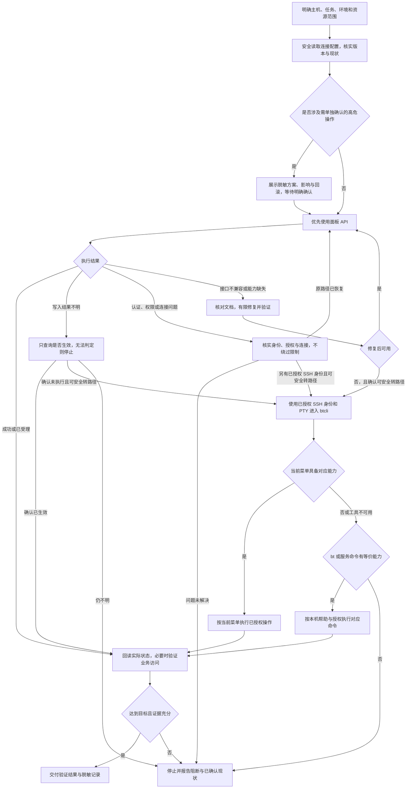
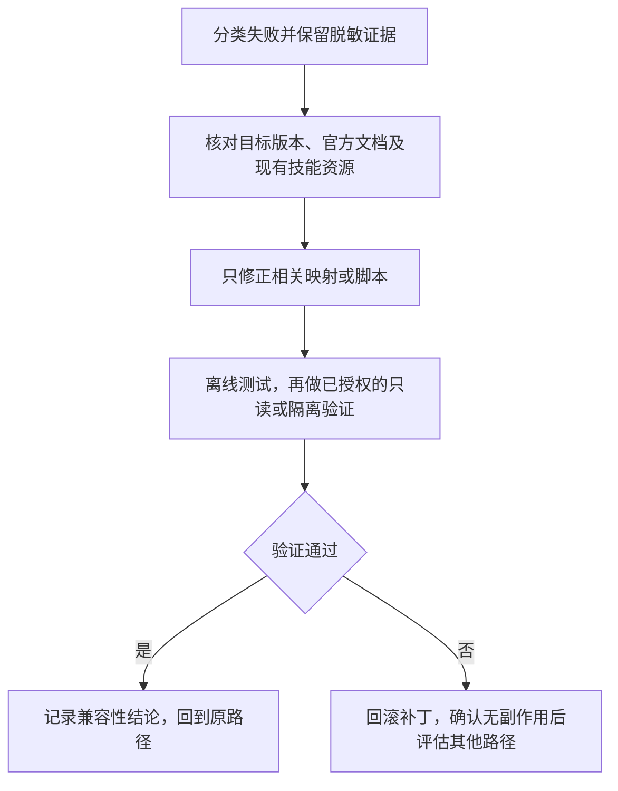

# axns-ops-bt

宝塔面板运维技能，支持 API 优先、SSH btcli 交互降级、bt/服务命令兜底，以及经过验证的接口兼容性修复。完整执行规则见 [SKILL.md](SKILL.md)。

## 工作流程

Agent 先核实现状，再选择可用执行路径。内置脚本只覆盖三项只读诊断；站点管理、部署和其他 API / SSH 操作由 Agent 按任务授权组织。



认证、权限或 TLS 问题需核实原因；切换路径必须使用有效且另行已授权的身份，不能绕过访问限制。写操作结果不明时先回读，无法证明未执行时停止，避免换路径重复写入。删除网站及关联资源、清空日志、修改数据库 root 密码等操作按 [安全规则](references/safety.md) 单独确认。

接口兼容性修复按下面的有限循环执行，每条路径最多进行一次有证据支持的补丁验证：



完整路径条件见 [执行说明](references/execution.md)，修复与记录要求见 [自进化流程](references/evolution.md)。

## 安装和调用

```bash
npx skills add axns8888/skill-repo --skill axns-ops-bt
```

在可访问目标项目和服务器的 Agent 中提出任务：

```text
使用 $axns-ops-bt，先检查主机别名 production-web 的面板版本、系统负载和磁盘。
本次只做诊断，遇到接口变化先核对官方资料并说明修复结果。
```

```text
使用 $axns-ops-bt，为已授权的测试服务器部署本项目。
先读取项目实际启动和构建配置，检查域名、目录与端口冲突，再执行部署并验证访问。
删除、覆盖生产数据或修改数据库 root 密码前，展示具体方案并等待我回复“确认”。
```

提供主机别名和必要的目标信息即可；真实 API Key、SSH 私钥及数据库密码通过环境变量、密钥库或既有 SSH 配置提供。

## 只读诊断脚本

依赖 Node.js 22+，只使用内置模块。把 `<SKILL_DIR>` 替换为本技能的真实目录。

```bash
node "<SKILL_DIR>/scripts/bt-api.cjs" --list
node "<SKILL_DIR>/scripts/bt-api.cjs" --operation system-summary
node "<SKILL_DIR>/scripts/bt-api.cjs" --validate-config
```

默认只展示不含凭证的请求计划，不联网。真正请求需要 `--execute`，并从进程环境读取：

- `BT_PANEL_URL`：面板 origin，例如 `https://panel.example.com:8888`，不包含登录安全入口、用户名、查询参数。
- `BT_API_KEY`：接口密钥，使用安全输入或密钥库注入；不要把真实值写入命令历史或版本文件。

```bash
node "<SKILL_DIR>/scripts/bt-api.cjs" --operation system-summary --execute
node "<SKILL_DIR>/scripts/bt-api.cjs" --operation system-load --execute
node "<SKILL_DIR>/scripts/bt-api.cjs" --operation disk-info --execute
```

成功输出受字段白名单约束的 JSON；HTTP 错误、面板业务拒绝、非 JSON、响应结构错误、重定向和超时均以非零退出，不自动重试。脚本不输出请求体、签名或原始错误响应，也不自动执行 SSH 或生产写操作。

远程连接必须 HTTPS；自签证书可在启动 Node 前通过 `NODE_EXTRA_CA_CERTS` 提供可信 CA，不关闭证书校验。`--allow-local-http` 仅允许 `127.0.0.1` 或 `[::1]` 的 HTTP，用于本地模拟服务或已建立的 SSH 隧道；隧道本身由操作者验证。

三级降级和真实部署由 Agent 按 [执行路径](references/execution.md) 完成。btcli 需要可用的 SSH PTY；环境缺失时报告阻断信息。

## 自更新和情景记忆

接口映射位于 [operations.json](config/operations.json)，有官方来源和核对日期。映射不能通过将任意 action 标注为只读而获得执行权限；脚本还会核对代码中的只读白名单。

修复步骤见 [自进化流程](references/evolution.md)。[操作计划](assets/operation-plan.template.json)和[情景记忆](assets/evolution-record.template.json)仅作为填写模板。运行记录默认保存在目标项目的 `.ops-bt-agent/`，先确保它被忽略，再写入脱敏内容；凭证不写入记录。

已安装的技能目录可能是缓存、符号链接或独立副本。持久更新应在对应技能源仓库中完成；安装副本不会自动同步，也不自动创建远程 PR 或推送到第三方仓库。

## 验证

在本仓库根目录：

```bash
node --test tests/axns-ops-bt.test.cjs
npx skills add . --list
```

测试使用本地模拟 HTTP 服务；不连接真实宝塔服务器。真实面板版本、API IP 白名单、权限、btcli 菜单和部署后的业务健康仍需在目标环境验证。

技能改名为 `axns-ops-bt` 后，私有记录仍使用 `.ops-bt-agent/`，沿用已有记录和忽略规则。
