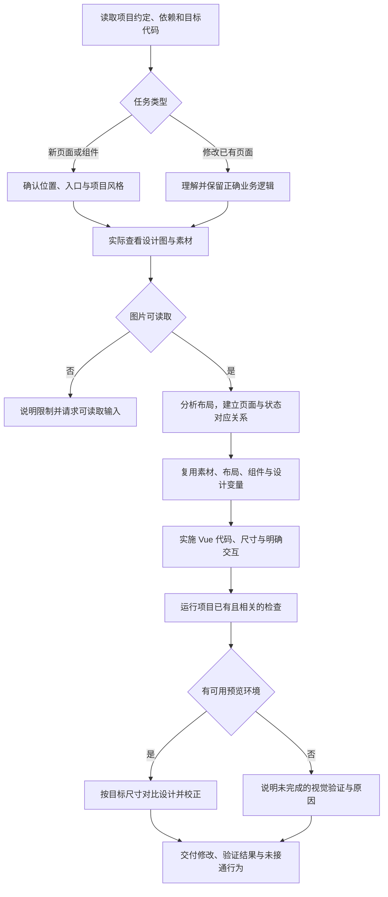

# axns-ui-img2vue

根据单张 UI 截图、批量设计图生成 Vue 3 页面与组件，或按图修改已有页面。完整执行规则及三种调用示例见 [SKILL.md](SKILL.md)。

默认由当前智能体和会话模型直接看图、编辑代码，使用宿主已有工具；不需要额外模型服务密钥或外部转换器。沿用项目的组件库、样式、路由和已有正确业务逻辑，支持同页多状态整合与公共布局复用。

## 工作流程



批量图根据实际内容区分页面与状态，不仅按文件名分组。视觉实现不等于接口、权限、数据流与业务联调完成；不能从截图确定的行为须说明，不承诺像素级还原。

## 本地调用

在能读取目标项目和图片的宿主中使用：

```text
使用 $axns-ui-img2vue，对照 design/profile-new.png 修改
src/views/profile/index.vue。先读取项目约定并理解现有实现，保留正确的
接口、权限、表单校验和保存行为，沿用已有组件库、样式与素材。
完成后运行相关检查，有浏览器能力时按目标尺寸对照原图校正，
说明修改文件、实际验证结果及尚未接通或未验证的部分。
```

也可直接指定本仓库中的 `skills/axns-ui-img2vue/SKILL.md`。

## 安装与同步

本仓库是源码入口，本机已安装副本与源码独立。按照仓库的[本地开发与跨电脑复用说明](../../docs/local-development.md)更新锁文件、验证并同步；此技能包含在 `--profile all` 中，默认的 devflow 配置不包含它。

发布到 GitHub 后可单独远程安装：

```sh
npx skills add axns8888/skill-repo --skill axns-ui-img2vue
```

旧 `ui-to-vue` 已由此技能替代，后续修改和复用以本目录为准。
